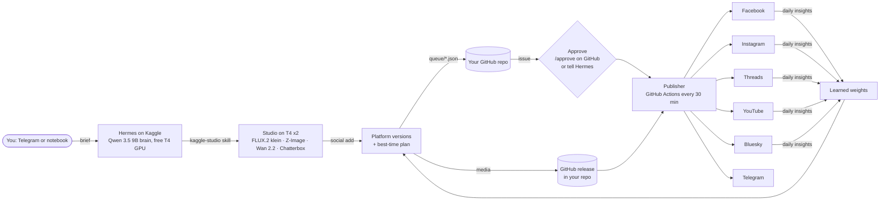

# Hermes Social Studio (free edition)

An AI content studio directed by **Hermes Agent**, end to end, at **zero cost**. Hermes runs on
**Kaggle's free GPUs** with an open brain model and makes images, video clips and narrated films with
open models. A publisher on **GitHub Actions' free runners** then posts them to **Facebook** (posts,
photos, albums, videos, Reels, Stories), **Instagram** (images, carousels, Reels, Stories),
**Threads**, **YouTube** (Shorts, videos), **Bluesky** and a **Telegram channel**. Each post goes out
at the best time for your audience, and the schedule learns from your own engagement. Nothing runs on
your computer, and no paid API or subscription is needed.



## Everything here is free

| Part | Runs on | Cost |
|---|---|---|
| Hermes Agent + brain (Qwen 3.5 9B via Ollama) | Kaggle notebook, GPU 0 | free, ~30 GPU-hours/week |
| Images, video, voice (FLUX.2 klein, Z-Image-Turbo, Wan 2.2, Chatterbox) | Kaggle notebook, GPU 1 | free, open weights |
| Queue, schedule, approvals, encrypted vault | your GitHub repo | free |
| Media storage until posted | GitHub releases in your repo | free (2 GiB per file) |
| Publisher, insights, approval bot | GitHub Actions | free on public repos; a private repo uses ~1,500 of its 2,000 free minutes a month |
| Facebook, Instagram, Threads, YouTube, Bluesky, Telegram APIs | the platforms | free |
| Public links for Instagram images | your Facebook Page (default) | free |
| Public links for Threads videos (optional) | Backblaze B2 bucket | free up to 10 GB |
| Instant replies from the control bot (optional) | Cloudflare Worker | free (100,000 requests/day) |

**Not included: X (Twitter).** Its API is pay-per-use only, so it does not fit a free build.

## Setup (about an hour, once)

1. **Your repo.** Create a new **private** GitHub repo and push this code to it
   ([docs/setup-github.md](docs/setup-github.md)). Add the repository secret `SOCIAL_VAULT_PASSPHRASE`.
2. **Kaggle.** Import [`kaggle/hermes_social_studio.ipynb`](kaggle/hermes_social_studio.ipynb), set GPU T4 x2
   and Internet on, and add the secrets `GITHUB_TOKEN` (a fine-grained token for this repo) and
   `SOCIAL_VAULT_PASSPHRASE`. Put your repo name in the first cell.
3. **Run all.** The setup cell installs everything (~10 min), and the *Connect accounts* cell
   creates the encrypted vault in your repo. Set your audience's timezone in `studio.toml` (it starts
   as Africa/Nairobi).
4. **Connect accounts** in the notebook's *Connect accounts* cell. You type every secret yourself into
   hidden fields; Hermes never sees them.

| Platform | In the notebook | Guide | You need |
|---|---|---|---|
| Facebook Page + Instagram | `social("auth", "facebook")` | [setup-facebook-instagram.md](docs/setup-facebook-instagram.md) | a Page, an Instagram professional account linked to it, a free Meta app |
| Threads | `social("auth", "threads")` | [setup-threads.md](docs/setup-threads.md) | a Meta app with the Threads use case |
| YouTube | `social("auth", "youtube")` | [setup-youtube.md](docs/setup-youtube.md) | a Google Cloud project (free) |
| Bluesky | `social("auth", "bluesky")` | [setup-bluesky.md](docs/setup-bluesky.md) | an app password |
| Telegram channel | `social("auth", "telegram")` | [setup-telegram.md](docs/setup-telegram.md) | a bot that is admin of your channel |
| Media links (optional) | `social("auth", "hosting")` | [setup-hosting.md](docs/setup-hosting.md) | only for Threads videos |

5. **Check.** `social("doctor", "--online")` checks that every account is reachable.
6. **Dry run, then live.** The studio starts in `mode = "dry-run"` with `approval = "required"`. Queue a
   post, approve it, and read the *publish* workflow log on GitHub: it lists what would have been posted.
   When that looks right, run `social("mode", "live")`.

## Autopilot and Telegram control

- **Autopilot** ([docs/autopilot.md](docs/autopilot.md)):
  - Write your weekly plan in `autopilot.toml`: which kinds of posts, on which days, for which platforms.
  - Every morning GitHub starts a Kaggle run. Hermes makes the day's posts, and the publisher schedules them at the best times.
  - You approve each post from Telegram. With `approval = "timeout"`, a post goes out unless you reject it within 3 hours.
- **Control bot** ([docs/telegram-control.md](docs/telegram-control.md)): a Telegram bot for `/studio`, `/autopilot`, `/status`, `/queue`, `/pause` and `/resume`, with Approve/Reject buttons under every post.
  - `/studio` starts Hermes on Kaggle for you to chat with, and it switches off when idle.
  - Instant replies need a free Cloudflare Worker. Without one, replies come within about 30 minutes.

## Everyday use

Talk to Hermes on Telegram, or with `ask("...")` in the notebook:

> Make a 45-second Short about how Kenyan coffee is grown, energetic narration, end with a line in
> Swahili. Then queue it for Instagram, Facebook, YouTube and Telegram at the best times.

> What's scheduled this week? Move Thursday's reel to 19:00.

> How did last week's posts do?

Hermes renders the film, writes a caption for each platform, and runs `social add`. That makes the
platform versions (9:16 for Reels, Shorts and Stories, size-capped files for Bluesky and Telegram),
uploads them to a release in your repo, and picks a time for every target. Then it shows you the plan.
Approve by telling Hermes, or comment `/approve` on the GitHub issue that opens for every post. GitHub's
mobile app works for this. The publisher posts it within half an hour of each planned time.

| Approval comment | Effect |
|---|---|
| `/approve` | post every target as planned |
| `/approve instagram,youtube` | only these; cancel the rest |
| `/move instagram:reel 2026-10-09 19:00` | pin a target to a local time |
| `/now` or `/now youtube:short` | post at the next run |
| `/reject` | cancel the post |

## How the timing works

Every free half-hour in the next 7 days gets a score of **research prior × your learned weight ×
urgency**, in your audience's timezone:

- **Priors:** Sprout Social's 2026 best-time windows for Facebook and Instagram. Threads and Bluesky use
  the same windows as X, since they are also text-first feeds. YouTube, Telegram and Stories use
  heuristics.
- **Limits:** per-platform daily caps, minimum gaps, quiet hours, and a separate lane for Stories.
- **Learning:** once a day, the *insights* workflow compares each post's engagement with that platform's
  recent median. It then nudges that weekday and hour up or down, staying between 0.5× and 2×.

Details are in [docs/scheduling.md](docs/scheduling.md).

## Platform facts this is built on (October 2026)

- **Meta Graph API v25.0.**
  - Facebook Reels and video Stories use a 3-phase upload to `rupload.facebook.com`. Reels must be 3–90 s.
  - Instagram Reels and video Stories upload as binary (resumable).
  - Instagram images must be JPEGs at a public URL. They are served through an unpublished photo on
    your Page, which is deleted after posting.
  - Instagram allows 100 API posts per 24 h. We cap hashtags at 5.
- **Threads API.**
  - Threads fetches all media from a public URL.
  - Text posts are limited to 500 characters, with one topic tag.
  - Tokens last 60 days and are renewed weekly by the publisher.
- **YouTube Data API v3.**
  - Uploads from API projects Google has not audited are **forced private**. The audit is free.
  - The doctor and every upload result tell you when this applies.
  - Uploads are flagged `containsSyntheticMedia`.
- **Bluesky.**
  - Posts are limited to 300 characters.
  - You can attach up to 4 images, or a video of up to 3 minutes through the video service.
  - Links and hashtags become real facets.
- **Telegram Bot API.** Uploads are limited to 50 MB, so videos are compressed to fit.

## Honest limits

- **Brain:** a 9B model on a T4 plans and writes less cleverly than a frontier model. The skills keep
  its job simple, and every result reaches you for approval first.
- **Timing:** the publisher runs every 30 minutes, and GitHub can delay scheduled runs when it is busy.
  Posts go out within roughly half an hour of their slot.
- **Kaggle sessions:** they end when idle. Making media needs a running session; posting does not.
- **First live run:** nothing here has posted to a real account yet. Every request shape is tested
  against the platforms' documented APIs, and the Kaggle-to-GitHub flow is tested end to end in a
  simulation. Still, the first live post of each platform is the real test, which is why the studio
  starts in dry-run mode.

## Security

The full model is in [SECURITY.md](SECURITY.md). In short:

- **Vault:** every credential lives in `state/vault.enc`, encrypted with scrypt + Fernet, names
  included.
- **Passphrase:** only in GitHub and Kaggle secrets.
- **Output:** everything printed is redacted.
- **Hermes:** the agent never needs platform tokens. It queues posts; publishing runs on GitHub.
- **Meta calls:** each one carries `appsecret_proof`.
- **OAuth:** uses PKCE and `state`.
- **Approvals:** only the repo owner and collaborators are obeyed.
- **Repo scanning:** gitleaks runs in pre-commit and CI.

## Development

```bash
pip install -e ".[dev]"
python -m pytest -q                         # 78 tests; needs ffmpeg
node launcher/worker.test.mjs               # the Cloudflare Worker relay
python scripts/selftest.py                  # offline end-to-end with the real CLI
python studio/tests/check_studio_e2e.py     # the Kaggle studio against fake ComfyUI/Ollama
sudo python kaggle/sim/run_sim.py           # the notebook end to end, simulated Kaggle + GitHub
sudo python kaggle/sim/run_autopilot_sim.py # a full autopilot day: launch -> Kaggle run -> collect
pre-commit install
```

## Responsible use

- **Rights:** only publish content you have rights to, and only clone voices or use music you own or
  have permission for.
- **AI labels:** label AI-generated media where platforms ask. YouTube uploads are labelled
  automatically.
- **Platform rules:** follow each platform's rules on automation and spam. The daily caps help.
- **Kaggle:** use one account and don't try to get around quotas or idle limits.

MIT licensed.
